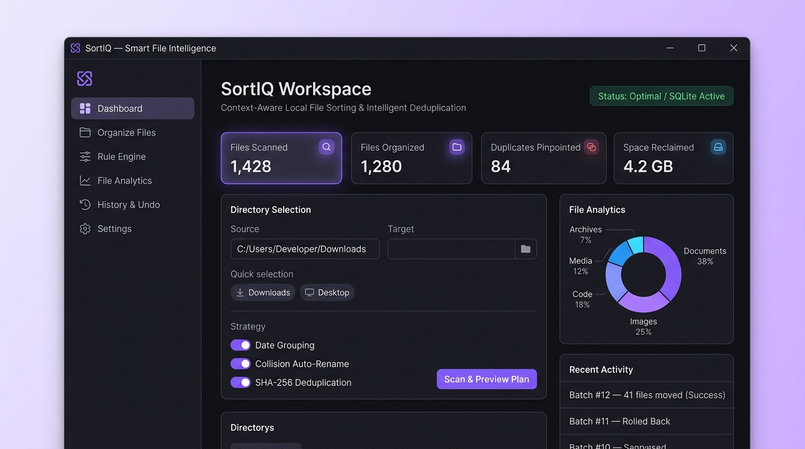
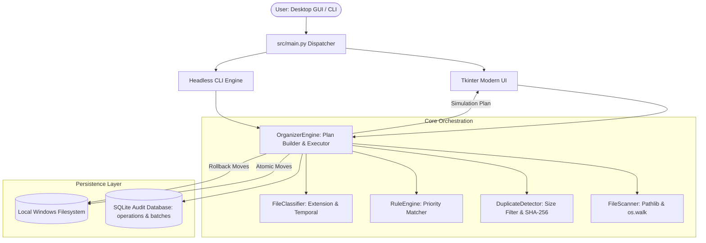

# SortIQ — Smart File Intelligence
### Context-Aware Desktop File Organization Automation Engine

[](https://www.python.org/)
[](https://docs.python.org/3/library/tkinter.html)
[-orange.svg)](https://www.sqlite.org/)
[-brightgreen.svg)]()
[]()
[](LICENSE)

**SortIQ** is a modern desktop file organization utility that transforms disorganized download directories into clean, structured file hierarchies in a single click. It features an obsidian & electric violet design system, a priority-ordered rule engine, two-tier cryptographic duplicate detection, safety dry-run preview simulation, and enterprise-grade transaction rollback via a local SQLite audit log.

---

## 1. Project Title & Description

**Professional Project Title**: SortIQ — Context-Aware Desktop File Organization Automation  
**Day 3 Project** of the **90 Days – 90 Projects Challenge**  
**Developer**: Final-Year B.Tech Artificial Intelligence & Data Science Student  

SortIQ is an autonomous local filesystem utility that scans, classifies, deduplicates, and organizes cluttered folders using deterministic rule evaluation, temporal date hierarchies, and reversible SQLite-audited operations.

---

## 2. Problem Statement & Motivation

Downloads folders and desktop surfaces inevitably become cluttered with hundreds of mixed files:
- Business and financial receipts, tax filings, and enterprise invoices mixed with personal documents.
- Developer assets (Python scripts, JS bundles, SQL schema dumps, machine learning datasets).
- Multi-gigabyte video recordings, podcasts, and compressed installation packages (`.exe`, `.msi`, `.iso`).
- Redundant and duplicate downloads of identical files wasting valuable local disk space.

Manual sorting is tedious, error-prone, and carries high risk of accidental overwrites. This project provides an automated, deterministic desktop tool that eliminates clutter while ensuring **zero data loss** through full preview simulation and reversible operations.

---

## 3. Objectives & Intended Users

### Primary Objectives
- Automate multi-format classification into semantic categories (Documents, Images, Audio, Video, Archives, Code, Spreadsheets, Installers).
- Enable user-defined rule creation with wildcard and regex pattern matching, file size bounds, and modification age filters.
- Reclaim disk storage by pinpointing identical files using streaming SHA-256 cryptographic hashing.
- Provide full transaction auditability: every file move is recorded in SQLite and can be rolled back in one click.
- Deliver an intuitive desktop GUI alongside a headless CLI for background automation and Windows Task Scheduler scripting.

### Intended Users
- **Software Engineers & Developers**: Organize raw datasets, repo snapshots, and project scripts.
- **Students & Researchers**: Automatically categorize lecture slides, PDF research papers, and academic notes.
- **Content Creators & Designers**: Group multimedia assets, mockups, and high-resolution screen recordings.
- **Everyday Power Users**: Keep Windows Downloads and Desktop folders perpetually tidy.

---

## 4. Key Features

- **High-Throughput File Scanning**: Recursively or shallowly traverses directories, extracting file sizes, created/modified timestamps, extension details, and hidden file flags.
- **Semantic Extension Classification**: Pre-configured out of the box with 10+ standard file categories with customizable extension mappings.
- **Hierarchical Temporal Clustering**: Group files chronologically by Year (`2026/`), Year-Month (`2026-10/`), or Full Date (`2026-10-19/`).
- **Two-Tier Cryptographic Deduplication**:
  - *Tier 1*: Rapid O(N) grouping by exact file size in bytes (skips 90%+ of unique files without reading disk content).
  - *Tier 2*: Streaming SHA-256 hashing in 64KB chunks to identify exact binary clones and report wasted disk space.
- **Custom Priority Rule Engine**: Define custom rules using wildcards (`*invoice*`, `*receipt*`), regular expressions (`regex:^Screenshot_\d+`), extension filters, and file size constraints.
- **Dry-Run Simulation & Plan Preview**: Interactive table displaying exact proposed source-to-target routes, matched rules, collision tags, and duplicate warnings before touching any disk files.
- **Collision Resolution Modes**:
  - `rename`: Automatically appends incremental counter `(1)`, `(2)` to eliminate overwrites.
  - `skip`: Leaves colliding files untouched.
  - `overwrite`: Explicit replacement when intended.
- **One-Click Reversible Undo**: The SQLite database records every operation. Users can reverse any past organization run, returning all files to their exact original locations.
- **Audit Reporting & Export**: Export complete operations history into standard CSV or JSON format.
- **Standalone Windows Executable**: Compiles into a single self-contained `.exe` via PyInstaller.

---

## 5. UI Screenshots & Visual Guide

The application features a modern desktop interface inspired by tools like Linear and Raycast, designed with an **Obsidian & Charcoal canvas (`#101014`)**, electric violet brand accents (`#8B5CF6`), and a vertical navigation command sidebar.



```
+----------------------------------------------------------------------------------------------------------+
| ⬢ SortIQ  [SMART FILE INTELLIGENCE]                        ● Status: Optimal / SQLite Active             |
+----------------------------------------------------------------------------------------------------------+
|  [SIDEBAR]            |  [DASHBOARD WORKSPACE]                                                           |
|  NAVIGATION           |  SortIQ Workspace                                                                |
|  ▌ 📊 Dashboard       |  Context-Aware Local File Sorting • Cryptographic SHA-256 Deduplication           |
|    📁 Organize Files  |                                                                                  |
|    ⚙️ Rule Engine      |  [ 📁 SCANNED: 41 ]  [ 🚀 ORGANIZED: 41 ]  [ ⚠️ DUPLICATES: 6 ]  [ 💾 RECLAIMED: 317 B ]|
|    🚀 Plan Simulation |                                                                                  |
|    📜 History & Undo  |  QUICK FOLDER SORTING                     |  FILE ANALYTICS                      |
|    ⚙️ Settings         |  Source: [ D:\Downloads\Sample_Clutter ]  |  [ Donut Chart: Documents 38%        |
|                       |  Presets: [Downloads] [Desktop] [Clutter] |                 Images 25%, Code 18% |
|  SYSTEM METRICS       |  [ 🚀 Scan & Preview Plan ] [Configure]   |                 Media 12%, Other 7% ]|
|  Organized: 41 files  |                                                                                  |
|  Batches: 1           |  RECENT BATCH ACTIVITY                                                           |
|                       |  #batch-20261019-211421  | D:\Downloads  | 41 files | COMPLETED                  |
+----------------------------------------------------------------------------------------------------------+
| Ready.                                                                           [ Progressbar ]         |
+----------------------------------------------------------------------------------------------------------+
```

---

## 6. Architecture Overview



For detailed architectural specifications and sequence diagrams, refer to [docs/ARCHITECTURE.md](docs/ARCHITECTURE.md).

---

## 7. Technology Stack

| Layer | Component / Library | Purpose |
| :--- | :--- | :--- |
| **Language** | Python 3.10+ (Tested on 3.14) | Core backend logic and automation pipelines |
| **Frontend** | Tkinter & `ttk` | Responsive native Windows desktop interface |
| **Database** | SQLite 3 (`file_organizer.db`) | Audit operations table, batch logs, and custom rules |
| **Filesystem & I/O** | `pathlib`, `shutil`, `os` | Atomic file moves, path resolution, and metadata reading |
| **Security & Hashing**| `hashlib` (SHA-256) | Streaming cryptographic duplicate detection |
| **Testing** | `pytest` 8.0+, `pytest-cov` | Automated unit and integration test suite |
| **Packaging** | `pyinstaller` 6.4+ | Compiles standalone single-file Windows `.exe` |

---

## 8. Project Directory Structure

```
90-days-90-projects-day-03-intelligent-file-organizer/
├── README.md                           # Main documentation & recruiter presentation
├── QUICKSTART.md                       # Fast-track installation instructions
├── DEMO_SCRIPT.md                      # 90-second portfolio walkthrough script
├── LICENSE                             # MIT Open Source License
├── .gitignore                          # Git exclusions for Python, venv, and builds
├── .env.example                        # Sample environment configuration
├── requirements.txt                    # Python dependency manifest
├── pyproject.toml                      # Build toolchain & pytest configuration
├── setup.bat                           # 1-Click Windows setup script
├── run.bat                             # 1-Click GUI launcher script
├── test.bat                            # 1-Click test runner script
├── build_exe.bat                       # 1-Click PyInstaller executable compiler
├── docs/                               # Deep-dive technical documentation
│   ├── PROJECT_OVERVIEW.md             # Goals, use cases, and MVP boundaries
│   ├── ARCHITECTURE.md                 # System components and Mermaid diagrams
│   ├── USER_GUIDE.md                   # Complete operational user guide
│   ├── DEVELOPMENT_NOTES.md            # Design decisions, trade-offs, and rationale
│   ├── TESTING.md                      # Test matrix, commands, and actual outputs
│   └── TROUBLESHOOTING.md              # Troubleshooting guide for common errors
├── data/                               # Sample benchmark dataset
│   ├── README.md                       # Dataset schema and generation notes
│   └── sample_clutter/                 # 41 realistic cluttered test files
├── screenshots/                        # UI demonstration visual assets
│   └── README.md                       # Capture guide and screen ASCII diagrams
├── scripts/                            # Utility and maintenance scripts
│   ├── generate_sample_data.py         # Synthetic downloads clutter generator
│   ├── capture_screenshots.py          # Automated screenshot capture utility
│   └── build_executable.py             # PyInstaller compilation driver
├── src/                                # Application source code
│   ├── __init__.py                     # Package initialization
│   ├── scanner.py                      # Filesystem scanner & metadata extraction
│   ├── classifier.py                   # Extension categorization & temporal logic
│   ├── rules.py                        # Priority-ordered rule evaluation engine
│   ├── duplicates.py                   # Two-tier duplicate detection (SHA-256)
│   ├── database.py                     # SQLite transaction logging & rule storage
│   ├── engine.py                       # Plan creation, execution, and rollback
│   ├── ui/                             # Tkinter desktop frontend
│   │   ├── __init__.py                 # UI package exports
│   │   └── app.py                      # Modern 4-tab desktop application
│   └── main.py                         # Unified GUI and CLI dispatcher entrypoint
└── tests/                              # Automated test suite (24 tests)
    ├── test_scanner.py                 # Scanner unit tests
    ├── test_classifier.py              # Classifier unit tests
    ├── test_rule_engine.py             # Rule engine unit tests
    ├── test_duplicate_detector.py      # Duplicate detector tests
    ├── test_database.py                # Database and export tests
    ├── test_organizer.py               # Move, collision, and rollback tests
    └── test_cli.py                     # CLI argument and workflow tests
```

---

## 9. Prerequisites

- **Operating System**: Microsoft Windows 10 or Windows 11 (64-bit recommended).
- **Python Runtime**: Python 3.10, 3.11, 3.12, 3.13, or 3.14.
- **Disk Space**: ~50 MB for source environment; ~15 MB for standalone executable.
- **Permissions**: Standard user account (No Administrator privileges required).

---

## 10. Step-by-Step Windows Installation

### Option A: One-Click Setup (Recommended)
Simply double-click `setup.bat`. This automatically:
1. Detects your Python installation.
2. Creates an isolated virtual environment at `.venv\`.
3. Installs `pytest`, `pytest-cov`, `pillow`, and `pyinstaller`.
4. Initializes local directories.
5. Populates `data/sample_clutter/` with 41 synthetic test files.

### Option B: Manual Setup
Open PowerShell or Command Prompt:
```powershell
# 1. Clone or navigate to the repository
cd "d:\90 days\90-days-90-projects-day-03-intelligent-file-organizer"

# 2. Create and activate virtual environment
python -m venv .venv
.\.venv\Scripts\Activate.ps1

# 3. Upgrade pip and install dependencies
pip install --upgrade pip
pip install -r requirements.txt

# 4. Generate the demo clutter dataset
python scripts/generate_sample_data.py
```

---

## 11. Quick Start Commands

```bash
# Launch Graphical Desktop Application
run.bat
# (or: .\.venv\Scripts\python src/main.py --gui)

# Run Automated Test Suite
test.bat
# (or: .\.venv\Scripts\pytest -v)

# Compile Standalone Windows .exe
build_exe.bat
# (or: .\.venv\Scripts\python scripts/build_executable.py)
```

---

## 12. Environment Variables & Configuration

A `.env.example` file is included in the project root:
```ini
# Default scan folder (leave blank to default to user Downloads folder)
ORGANIZER_DEFAULT_SCAN_DIR=

# Default collision resolution: rename, skip, overwrite
ORGANIZER_CONFLICT_RESOLUTION=rename

# Duplicate handling: report_only, quarantine, skip
ORGANIZER_DUPLICATE_STRATEGY=report_only

# Default temporal grouping: none, year, year_month, full_date
ORGANIZER_DATE_GROUPING=year_month

# SQLite database path
ORGANIZER_DB_PATH=file_organizer.db

# Console log verbosity: INFO, DEBUG, WARNING, ERROR
ORGANIZER_LOG_LEVEL=INFO
```

To customize defaults, copy `.env.example` to `.env`.

---

## 13. Dataset & API Setup

- **Dataset**: Built-in synthetic downloads clutter dataset located in `data/sample_clutter/`.
- **Generation**: Created automatically by `scripts/generate_sample_data.py`.
- **APIs Required**: None. The application operates 100% locally with zero external network or paid API requirements.
- **License**: Public Domain (CC0) Synthetic Benchmark.

---

## 14. Example Usage & CLI Automation

The engine includes a full headless CLI for automated maintenance and background jobs:

```bash
# 1. View historical organization metrics
.\.venv\Scripts\python src/main.py --stats

# 2. Inspect active rules in priority order
.\.venv\Scripts\python src/main.py --list-rules

# 3. Perform a safe dry-run scan on sample clutter (no files moved)
.\.venv\Scripts\python src/main.py --dry-run data/sample_clutter

# 4. Perform a dry-run with Year-Month date grouping
.\.venv\Scripts\python src/main.py --dry-run data/sample_clutter --date-grouping year_month

# 5. Execute actual organization
.\.venv\Scripts\python src/main.py --organize data/sample_clutter

# 6. Reversible rollback of a batch by Batch ID
.\.venv\Scripts\python src/main.py --undo batch_20261019_210000_a4f821

# 7. Export full operations history to CSV
.\.venv\Scripts\python src/main.py --export-csv audit_operations.csv
```

---

## 15. Testing Instructions & Actual Status

Automated testing is verified using `pytest`:

```cmd
test.bat
```

### Verified Test Results
- **Status**: **PASS (100%)**
- **Passed**: **24 passed in 2.64s**
- **Failed**: **0**

Tested areas include directory scanning, compound extension parsing, temporal classification, wildcard/regex rule evaluation, priority ordering, duplicate hashing, database transactions, filename collision renaming, and full batch rollbacks.

---

## 16. Known Limitations

1. **Active File Locks**: If a file is actively open in another application (e.g., Microsoft Word, Adobe Acrobat) or being actively downloaded by a browser, Windows will place a lock on it (`WinError 32`). The engine logs a warning for that file and safely proceeds with the rest of the batch.
2. **Cross-Drive Moves**: Moving files across different physical drive letters (e.g. from `C:\` to `D:\`) executes as a copy-and-delete under `shutil.move`, which is slightly slower than same-drive atomic renames.

---

## 17. Troubleshooting

- **File lock warnings**: Close applications holding open file descriptors before organizing.
- **Virtual environment issues**: Re-run `setup.bat` to rebuild `.venv`.
- For detailed error codes and resolutions, refer to [docs/TROUBLESHOOTING.md](docs/TROUBLESHOOTING.md).

---

## 18. Security & Privacy Considerations

- **100% Local Execution**: All scanning, hashing, rule processing, and database transactions occur exclusively on your local machine. No file names, contents, or metadata are ever transmitted across a network.
- **Zero In-Place Truncation**: Files are moved atomically using `shutil.move` without modifying file contents.
- **Safe Collision Handling**: Default collision mode auto-renames target files (`file (1).ext`) to ensure zero accidental overwrites.

---

## 19. Future Enhancements

- **Smart Content Classification**: Extract text from PDFs and TXT files using lightweight local NLP to cluster documents by topic.
- **Background Filesystem Watcher**: Integrate `watchdog` to monitor the Downloads folder and automatically file new downloads in real-time.
- **Cloud Drive Integrations**: Extend scanner and organizer to sync with Google Drive, OneDrive, and Dropbox.

---

## 20. Learning Outcomes

- Mastery of Python filesystem APIs (`pathlib`, `os`, `shutil`, `stat`).
- Real-world desktop UI engineering using Tkinter and `ttk` styles.
- Designing high-performance two-tier algorithms (O(N) size filtering + streaming SHA-256).
- Building transactional, reversible automation systems backed by SQLite audit logging.
- Standalone Windows application compilation using PyInstaller.

---

---

## 22. License & Attribution

This project is licensed under the **MIT License** — see the [LICENSE](LICENSE) file for details.  
Developed as part of the **90 Days – 90 Projects Challenge** by **Raguram R R P**.
