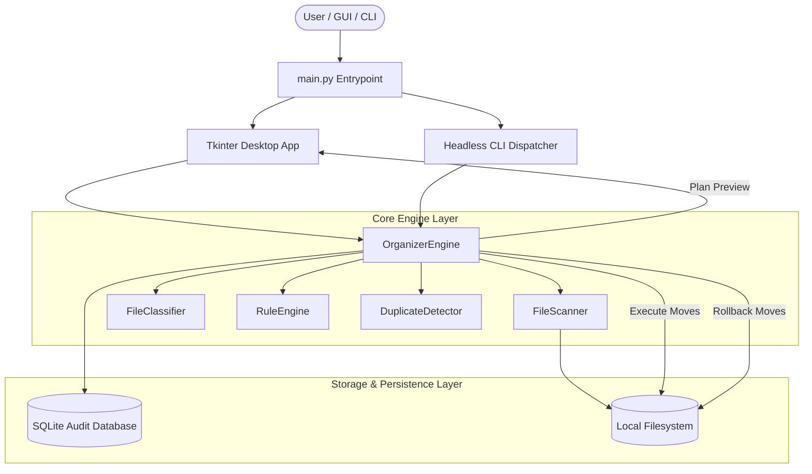
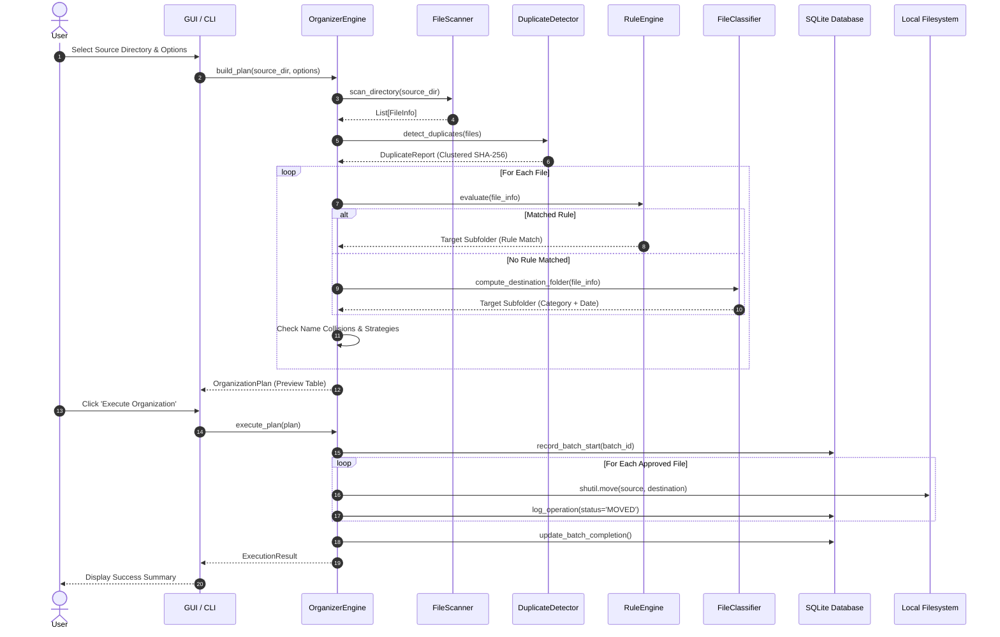

# System Architecture — Context-Aware Desktop File Organization Automation

This document provides a comprehensive technical breakdown of the architecture, module boundaries, data pipelines, and database schemas implemented in the **Context-Aware Desktop File Organizer**.

---

## 1. High-Level Architecture Overview

The system follows a modular, layered architecture adhering to the Single Responsibility Principle:



---

## 2. Core Modules & Responsibilities

| Module | File Path | Primary Responsibility |
| :--- | :--- | :--- |
| **Scanner** | `src/scanner.py` | Discovers files in target folders; extracts timestamps, file sizes, extensions, and hidden flags; handles filesystem permission safety. |
| **Classifier** | `src/classifier.py` | Maps extensions to semantic categories; formats temporal subfolder hierarchies (`YYYY`, `YYYY-MM`, `YYYY-MM-DD`). |
| **Rule Engine** | `src/rules.py` | Evaluates priority-ordered user rules based on wildcards, regex patterns, extension lists, file size bounds, and modified age. |
| **Duplicate Detector** | `src/duplicates.py` | Two-tier deduplication using O(N) file size bucketing followed by buffered 64KB streaming SHA-256 cryptographic hashing. |
| **Organizer Engine** | `src/engine.py` | Central orchestrator; constructs simulation plans, handles name collisions (`file (1).ext`), executes moves, logs audit trails, and performs rollbacks. |
| **Database Manager** | `src/database.py` | SQLite connection manager with WAL mode; persists batch summaries, granular move operations, and custom rule configurations. |
| **User Interface** | `src/ui/app.py` | Modern Tkinter GUI with custom typography, 4 notebook tabs, interactive preview table, rule dialogs, and progress bars. |
| **CLI Dispatcher** | `src/main.py` | Unified CLI parser supporting `--dry-run`, `--organize`, `--undo`, `--stats`, and `--export-csv`. |

---

## 3. Workflow Data Pipeline



---

## 4. SQLite Database Schema

The database `file_organizer.db` provides transactional auditability and undo capabilities:

### Table: `batches`
Tracks execution runs and aggregate statistics.
```sql
CREATE TABLE batches (
    batch_id TEXT PRIMARY KEY,
    created_at TEXT NOT NULL,
    source_dir TEXT NOT NULL,
    target_dir TEXT NOT NULL,
    total_files INTEGER NOT NULL DEFAULT 0,
    moved_files INTEGER NOT NULL DEFAULT 0,
    skipped_files INTEGER NOT NULL DEFAULT 0,
    failed_files INTEGER NOT NULL DEFAULT 0,
    status TEXT NOT NULL DEFAULT 'IN_PROGRESS'
);
```

### Table: `operations`
Granular record of each file movement operation (matches specification requirement 13).
```sql
CREATE TABLE operations (
    id INTEGER PRIMARY KEY AUTOINCREMENT,
    batch_id TEXT NOT NULL,
    source TEXT NOT NULL,
    destination TEXT NOT NULL,
    timestamp TEXT NOT NULL,
    status TEXT NOT NULL,            -- 'MOVED', 'SKIPPED', 'FAILED', 'ROLLED_BACK'
    file_hash TEXT,
    file_size INTEGER DEFAULT 0,
    rule_matched TEXT,
    error_message TEXT,
    FOREIGN KEY (batch_id) REFERENCES batches(batch_id) ON DELETE CASCADE
);
```

### Table: `rules`
Stores user-customized organization rules and criteria.
```sql
CREATE TABLE rules (
    id INTEGER PRIMARY KEY AUTOINCREMENT,
    name TEXT NOT NULL,
    priority INTEGER NOT NULL DEFAULT 100,
    enabled INTEGER NOT NULL DEFAULT 1,
    target_folder TEXT NOT NULL,
    condition_json TEXT NOT NULL
);
```
